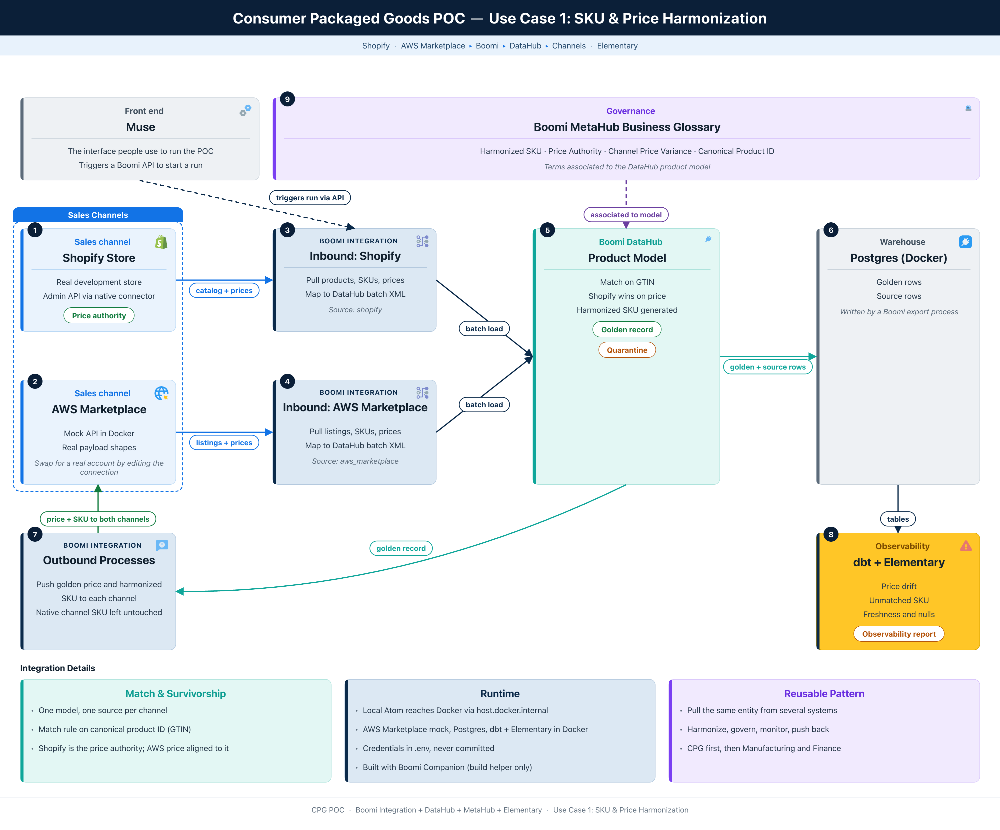

# SKU and Price Harmonization POC

A proof of concept for a reusable harmonization pattern: pull the same business entity from several
systems, match and merge it in **Boomi Data Hub**, push the harmonized result back, explain it in
**MetaHub**, and watch data quality with **dbt and Elementary**. A person drives it in plain language
from **Muse**.

The first use case is consumer packaged goods (CPG): product **SKU and price across two sales
channels**, Shopify (a real development store) and AWS Marketplace (a mock that follows the real
Catalog API shapes).

Boomi Companion (Claude Code) built it. It is not part of the running system.



## What you can do with it

Ask Muse, in plain language, to:

| Say | What happens |
|---|---|
| "Run the harmonization" | Both catalogs load into Data Hub and match on GTIN into one golden record per product. The harmonized SKU (`CPG-` plus the last 8 digits of the GTIN) and the winning price (Shopify wins) go back to both channels. dbt and Elementary then flag what is wrong: 3 price drifts and 2 unmatched AWS listings on the seed data. |
| "Change the price of the Cold Brew Coffee to 9.99" | Only Shopify changes. Run again and the AWS listing follows. |
| "What did the data-quality checks find?" | The latest results, including which products drifted and by how much. |
| "What does Price Authority mean?" | The endorsed MetaHub glossary terms, read live from MetaHub. |

## How it works

```
Muse -> public tunnel -> Boomi API Gateway (x-api-key) -> Boomi Atom (local, Docker)
                                                           |-> Shopify dev store (native connector)
                                                           |-> AWS Marketplace mock (REST)
                                                           |-> Boomi Data Hub (golden records)
                                                           |-> Postgres warehouse -> dbt + Elementary
                                                           |-> MetaHub (glossary, read-only)
```

Eight Boomi processes (in the Boomi folder `Sku Harmonization POC`, all named `HARM - ...`): four that move
data (inbound Shopify, inbound AWS Marketplace, outbound push, export golden records) and four listeners that
Muse calls, published by one API Service Component.

## Where to start

| I want to... | Read |
|---|---|
| understand what this is, why, and what is fragile | [`docs/handover/HANDOVER.md`](docs/handover/HANDOVER.md) |
| rebuild it on my own machine and accounts | [`docs/handover/REPLICATION_GUIDE.md`](docs/handover/REPLICATION_GUIDE.md) |
| run the demo, reset it, fix a failure | [`docs/runbook.md`](docs/runbook.md) |
| connect Muse | [`docs/muse/openapi.yaml`](docs/muse/openapi.yaml) |
| find a Boomi component or its ID | [`docs/platform-ids.md`](docs/platform-ids.md) |
| see the original design and the build plan | [`docs/superpowers/specs/`](docs/superpowers/specs/2026-10-28-sku-price-harmonization-design.md), [`docs/superpowers/plans/`](docs/superpowers/plans/2026-11-08-sku-price-harmonization.md) |
| turn the docs into polished guides with Claude chat | [`docs/handover/CLAUDE_CHAT_PROMPT.md`](docs/handover/CLAUDE_CHAT_PROMPT.md) |

## Repository layout

```
active-development/   Boomi component XML (processes, connections, operations, profiles, maps, the
                       API Service Component) and the Data Hub model and source XML. Account-specific;
                       see active-development/README.md before using any of it.
analytics/             dbt project, Elementary, and the FastAPI runner (/run, /results, /report, /glossary)
docs/                  handover, replication guide, runbook, Muse OpenAPI file, design spec, plan, diagrams
mock-sources/          Docker Compose, the AWS Marketplace mock, the warehouse schema
scripts/               reset.sh (back to the starting state in about 6 seconds), skill-paths.sh
seed/                  the CPG dataset and expected outcomes, the Shopify and MetaHub seed scripts, tests
.env.example           every setting, by name, with no values
CLAUDE.md, .claude/    instructions and permission presets for Boomi Companion
```

## Quick start (after the one-time setup in the replication guide)

```bash
cp .env.example .env          # fill it in; .env is git-ignored
python3 -m pip install -r requirements-dev.txt
python3 -m pytest -q          # 66 tests, all offline
cd mock-sources && docker-compose --env-file ../.env up -d --build && cd ..
bash scripts/reset.sh         # demo back to its starting state
```

Then ask Muse to run the harmonization. The Elementary dashboard is at `http://localhost:4121/report`.

## Status

All 15 plan tasks are built and verified end to end through the public gateway: 12 golden records, exactly 2
quarantined listings, every process idempotent, and a full walkthrough from reset (run, change a price, run
again, the AWS listing follows). Details and evidence are in the handover.

## Security

- Credentials live only in `.env` (git-ignored). The history was scanned against the real values before publishing.
- The Muse API is public through a tunnel and can change a Shopify price. It is protected by an API Management
  key sent in the `x-api-key` header. Treat the key like a password.
- Shared resources (the Shopify store, the Data Hub repository, the warehouse database) are touched only through
  the `harmonization-poc` tag, the `cpgproduct` model and the `harm_` table prefix.
